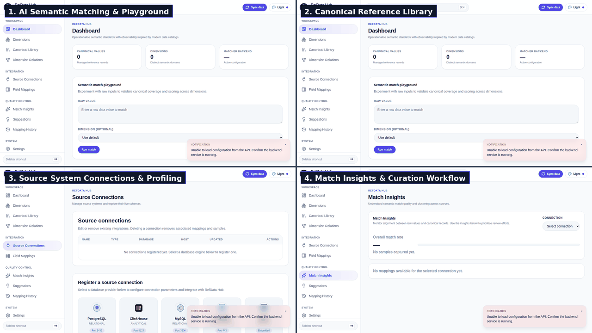
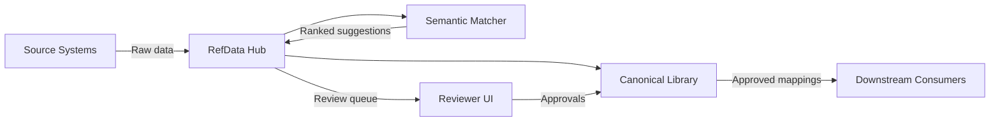

<div class="rdh-hero" markdown>

<p class="rdh-eyebrow">Reference Data Management &amp; Harmonization</p>

# Enterprise reference data, harmonized.

RefData Hub solves reference data fragmentation across multi-system
environments. Raw values — country codes, employment statuses, education levels,
marital statuses — vary wildly between source databases, analytics pipelines,
and third-party APIs. RefData Hub establishes a single source of truth:

</div>

<div class="rdh-hero-actions" markdown>

[Get Started](quickstart.md){ .md-button .md-button--primary }
[View on GitHub](https://github.com/rezer-bleede/refdata-hub){ .md-button .md-button--secondary }

</div>

<div class="rdh-steps" markdown>

1. **Ingest &amp; profile** raw values from upstream databases.
2. **Semantically match** them to canonical dimensions using embedding vectors,
   with lexical fallback and optional LLM re-ranking.
3. **Route to reviewers** who approve, reject, or refine suggestions in a
   purpose-built console.
4. **Publish** canonical mappings to downstream warehouses, BI tools, and
   services.

</div>

<div class="grid cards" markdown>

-   :material-view-dashboard: **Dashboard**

    ---

    Metric tiles plus a semantic match playground for instant feedback on how
    the matcher is scoring your data.

    [:octicons-arrow-right-24: Open the console](dashboard.md)

-   :material-book-open-variant: **Canonical Library**

    ---

    The approved golden records — labels, descriptions, and custom metadata
    attributes — that raw source values map into.

    [:octicons-arrow-right-24: Curate values](canonical-library.md)

-   :material-lightbulb: **Semantic Matching**

    ---

    ONNX sentence-transformer embeddings ranked by cosine similarity, with a
    lexical fallback so the queue never goes empty.

    [:octicons-arrow-right-24: Review suggestions](suggestions.md)

-   :material-source-branch: **Source Connections**

    ---

    Register upstream databases, test credentials inline, and introspect live
    schemas to drive mapping workflows.

    [:octicons-arrow-right-24: Connect a source](source-connections.md)

-   :material-chart-line: **Match Insights**

    ---

    Coverage rates, top matched and unmatched values, and mapping health per
    source field.

    [:octicons-arrow-right-24: Measure coverage](match-insights.md)

-   :material-history: **Mapping History**

    ---

    A full audit trail of every approved, corrected, or reverted mapping, with
    CSV and XLSX round-trip.

    [:octicons-arrow-right-24: Trace decisions](mapping-history.md)

</div>

<figure class="rdh-figure">
  
  <figcaption>The reviewer console in motion — coverage metrics, the canonical library, and the approval queue.</figcaption>
</figure>

## Quick start

```bash
git clone https://github.com/rezer-bleede/refdata-hub.git
cd refdata-hub
docker compose up --build
```

That starts PostgreSQL with seeded reference data, the FastAPI backend, and the
React reviewer UI:

| Service | URL |
| --- | --- |
| **Reviewer UI** | <http://localhost:5274> |
| **API** | <http://localhost:8000> |
| **API docs (Swagger)** | <http://localhost:8000/docs> |
| **PostgreSQL** | `localhost:5432` |
| **Demo warehouse (`targetdb`)** | `localhost:5433` |

To add a local LLM runtime for offline re-ranking:

```bash
docker compose --profile ollama up -d
```

Follow the [Quickstart Guide](quickstart.md) for local (non-Docker) setup,
first-run configuration, and seeding details.

## How it fits together



RefData Hub sits between source systems and downstream consumers, providing
intelligent harmonization through semantic matching and human curation.

## Where to go next

<div class="grid cards" markdown>

-   :material-rocket-launch: **Get running**

    ---

    Docker and local setup, first-run walkthrough, and seeding.

    [:octicons-arrow-right-24: Quickstart](quickstart.md)

-   :material-sitemap: **Understand the system**

    ---

    Component design, data flow, and the matching pipeline in depth.

    [:octicons-arrow-right-24: Architecture](architecture.md)

-   :material-api: **Integrate with it**

    ---

    48 REST endpoints across reference, source, config, and agent routers.

    [:octicons-arrow-right-24: API reference](api.md)

</div>

## Tech stack

- **Backend** — FastAPI (Python) with SQLModel / PostgreSQL
- **Frontend** — React 18 + Vite + Tailwind CSS
- **Matching** — ONNX sentence-transformer embeddings (default
  `BAAI/bge-small-en-v1.5`) + lexical fallback + OpenAI/Ollama LLM
- **Testing** — Pytest (backend) + Vitest (frontend)
- **Infrastructure** — Docker Compose, GitHub Pages for this documentation

## Use cases

- **Data warehousing** — harmonize reference data across source systems
- **Data quality** — detect and fix inconsistent reference values
- **Analytics** — enforce consistent dimensions across reporting layers
- **Data migration** — map legacy values onto new standards
- **Compliance** — maintain an auditable reference data mapping trail

## Support

- **Documentation** — you are reading it; see the [nav](quickstart.md) or the
  GitHub repository
- **Issues** — [github.com/rezer-bleede/refdata-hub/issues](https://github.com/rezer-bleede/refdata-hub/issues)
- **License** — [MIT](https://github.com/rezer-bleede/refdata-hub/blob/main/LICENSE)